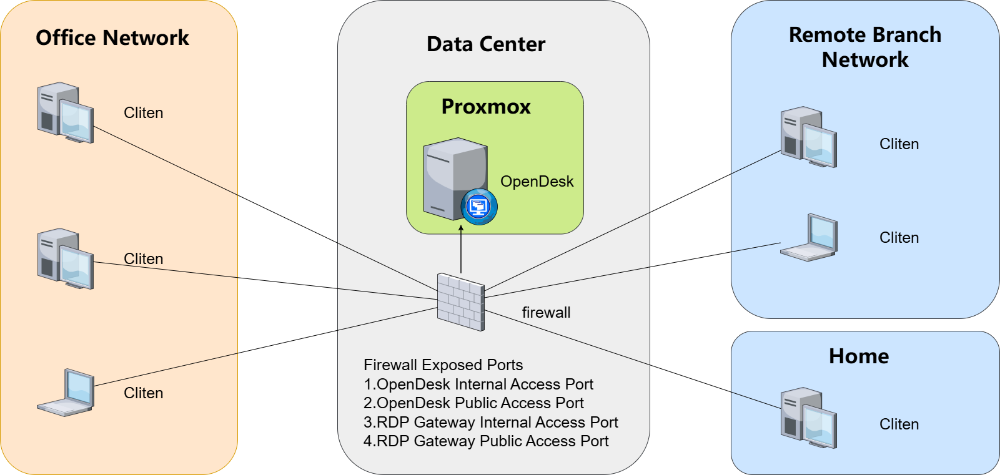

## Configure Gateway Proxy

### I. Purpose

Allows users to securely connect to intranet remote desktops over HTTPS without exposing RDP port 3389 directly to the public network.

### II. Network Diagram

| Cloud Desktop Component | IP/Domain |
| --- | --- |
| OpenDesk | 192.168.1.60 |
| Firewall | 192.168.1.71 |
| Domain (a public IP works the same way) | vdi.com |

### III. Intranet Gateway Proxy

OpenDesk connects to virtual machines through the intranet gateway by default, and administrators can also customize the gateway proxy. If the user's office network is isolated from the virtual machine network, configuring the intranet gateway is enough for secure access.

Note: If using nginx proxy, please use nginx-full stream mode for the gateway proxy port.

#### Disable Direct Connection

Disable direct connection in user management.

#### TCP Port Forwarding

| OpenDesk | Firewall | Purpose |
| --- | --- | --- |
| 192.168.1.60:443 | 192.168.1.71:1443 | Client login |
| 192.168.1.60:8443 | 192.168.1.71:8888 | RDP gateway |

Users can customize the mapped ports; ports 1443 and 8888 on 192.168.1.71 are examples only.

#### Configure the Intranet Gateway Proxy

Configure the intranet gateway proxy in System Settings: IP 192.168.1.71, port 8888.

#### Client Login

Set the client login server to 192.168.1.71:1443 to connect to virtual machines.

### IV. Public Network Gateway Proxy

#### Enable Public Network Gateway

Enable the public network gateway in user management.

#### TCP Port Forwarding

| OpenDesk | Firewall | Purpose |
| --- | --- | --- |
| 192.168.1.60:443 | vdi.com:2443 | Client login |
| 192.168.1.60:9443 | vdi.com:9999 | RDP gateway |

Users can customize the mapped ports; ports 2443 and 9999 on vdi.com are examples only.

#### Configure the Public Network Gateway Proxy

Configure the public network gateway proxy in System Settings: IP vdi.com, port 9999.

#### Client Login

Set the client login server to vdi.com:2443 to connect to virtual machines.
