## Install Thin Client System

### I. Create a Bootable USB Drive with rufus

Note: Select DD mode.

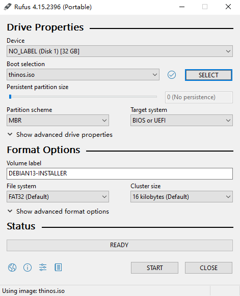

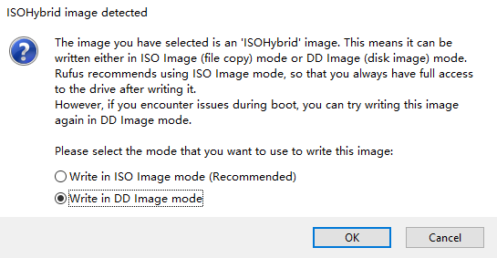

### II. Boot from USB Drive and Install the System

Use the boot shortcut key to boot from the USB drive.

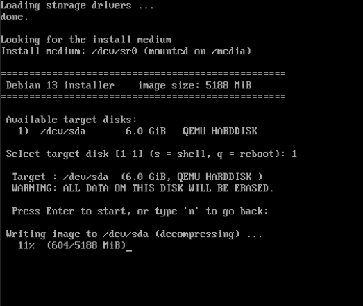

Steps to install thinos:

1. Enter the disk number and press Enter.

2. A warning that disk data will be overwritten appears; press Enter to start the installation.

3. Wait for the installation to complete, unplug the USB drive, and press Enter to reboot.

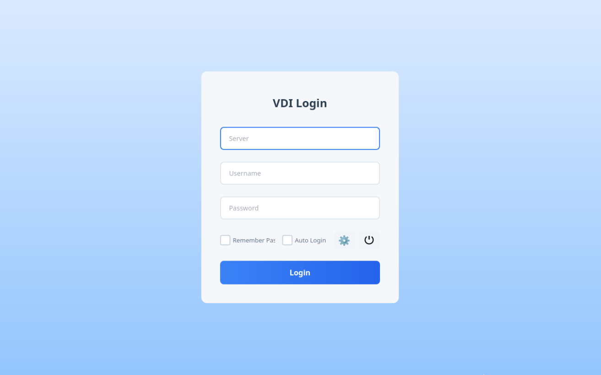

### III. Configure the Thin Client System

Click the settings button and configure as needed.

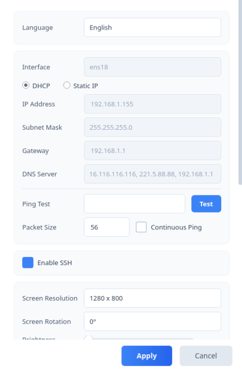

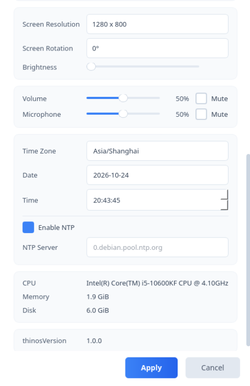

Configure the connection information on the login page.

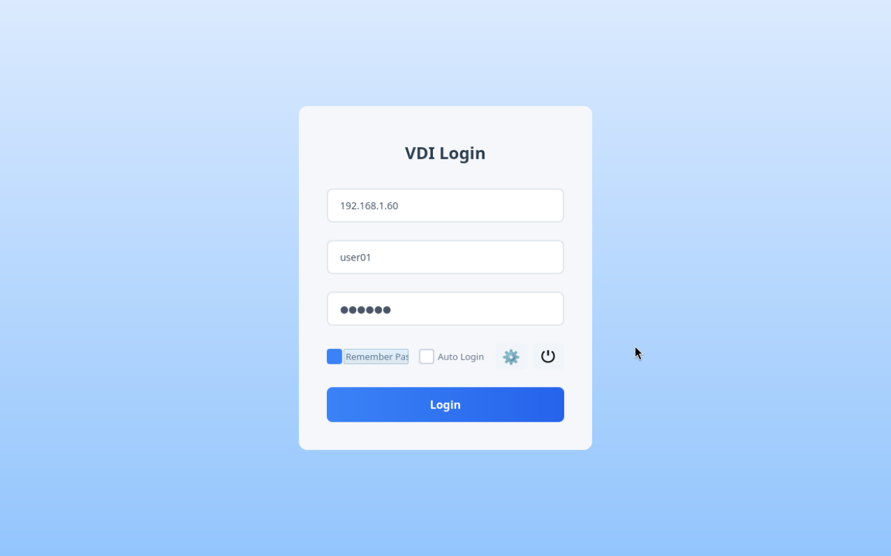

### IV. Login

Click Login to enter the virtual machine list page.

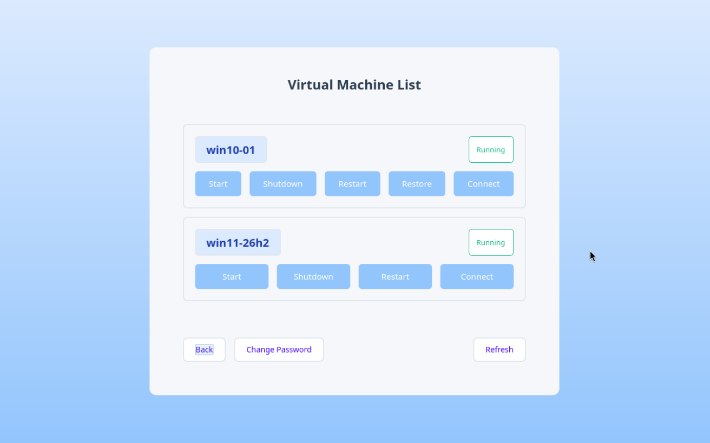

Click Connect to enter the virtual machine.

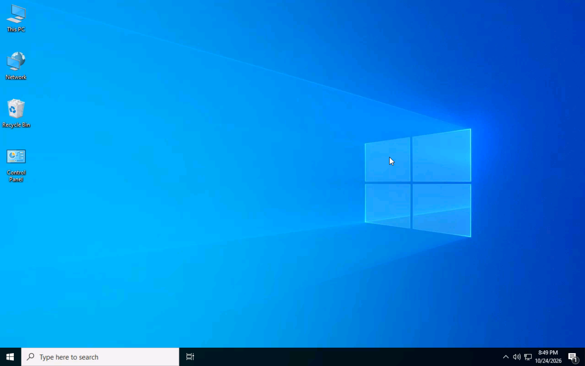

### V. Toolbar

Move the mouse near the top of the screen to show the floating toolbar, which supports the CAD (Ctrl+Alt+Del) shortcut, USB device redirection, and disconnecting.

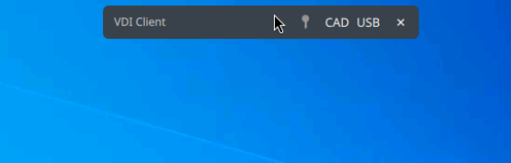

### VI. Change User Password

Click the change password button to change the user password.

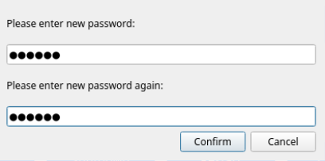

### VII. Operate Virtual Machines

Click the Start, Shut Down, Restart, or Restore (available only in restore mode) buttons, then click the Refresh button to update the virtual machine status.

After a virtual machine is started or restarted, it takes about 10-15 seconds before the user can click Connect to enter the virtual machine; otherwise, a connection failure will be reported.

### VIII. User Lockout

Entering an incorrect password 5 times will lock the user. Please contact the administrator to unlock.

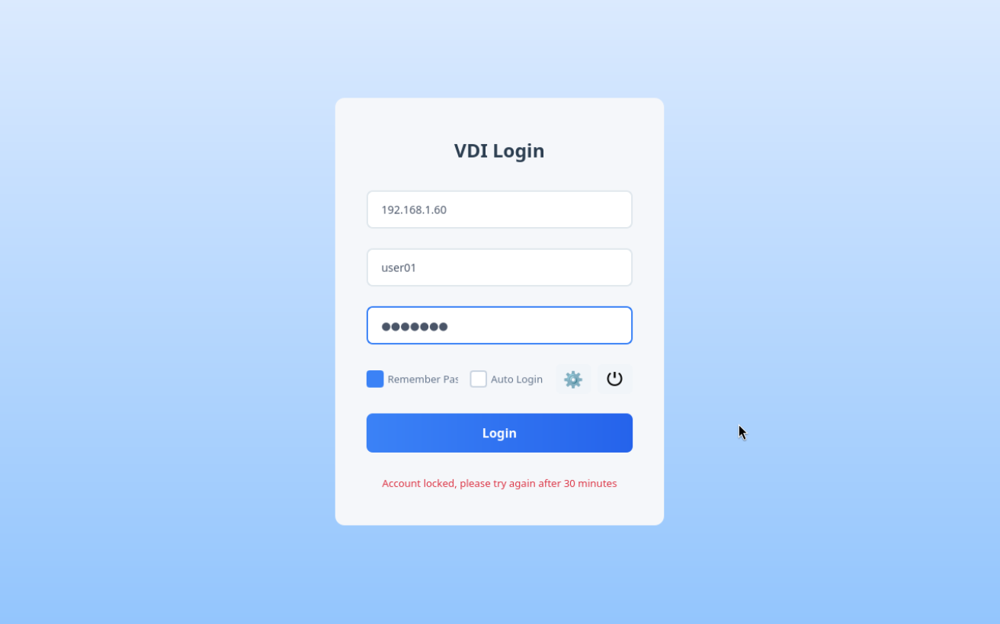
