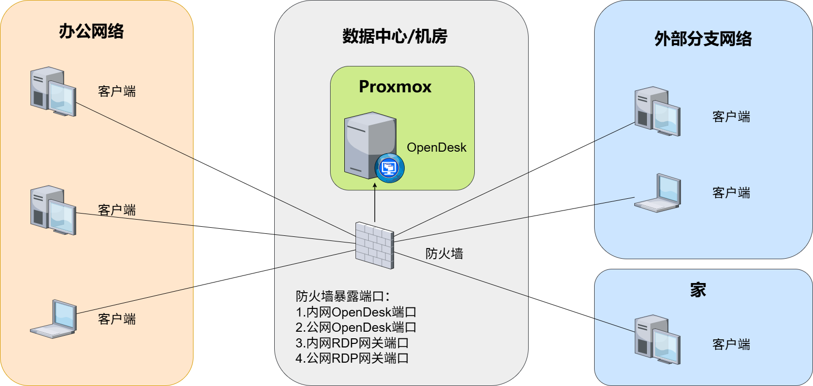

## 配置网关代理

### 一、作用

允许用户通过 HTTPS 安全地连接内网的远程桌面，而不需要直接向公网开放 RDP 的 3389 端口

### 二、组网图

OpenDesk：192.168.1.60

防火墙：192.168.1.71

域名：vdi.com（公网 ip 同理）

| 云桌面组件           | ip/域名      |
| -------------------- | ------------ |
| OpenDesk             | 192.168.1.60 |
| 防火墙               | 192.168.1.71 |
| 域名（公网 ip 同理） | vdi.com      |

### 三、内网网关代理

OpenDesk 默认使用内网网关连接虚拟机，同时允许管理员自定义网关代理。如果用户的办公网络和虚拟机网络隔离，配置内网网关即可安全访问。

注意：如果使用 nginx 代理，网关代理端口请使用 nginx-full 的 stream 模式。

#### 禁止直连

在用户管理中禁用直连

#### TCP 端口转发

| OpenDesk          | 防火墙            | 用途       |
| ----------------- | ----------------- | ---------- |
| 192.168.1.60:443  | 192.168.1.71:1443 | 客户端登录 |
| 192.168.1.60:8443 | 192.168.1.71:8888 | RDP网关    |

用户可自定义映射端口，192.168.1.71 的 1443 和 8888 端口仅示例

#### 配置内网网关代理

在系统设置中配置内网网关代理，ip：192.168.1.71，端口：8888

#### 客户端登录

客户端配置登录服务器为 192.168.1.71:1443，即可连接虚拟机

### 四、公网网关代理

#### 启用公网网关

在用户管理中启用公网网关

#### TCP 端口转发

| OpenDesk          | 防火墙       | 用途       |
| ----------------- | ------------ | ---------- |
| 192.168.1.60:443  | vdi.com:2443 | 客户端登录 |
| 192.168.1.60:9443 | vdi.com:9999 | RDP网关    |

用户可自定义映射端口，vdi.com 的 2443 和 9999 端口仅示例

#### 配置公网网关代理

在系统设置中配置公网网关代理，ip：vdi.com，端口：9999

#### 客户端登录

客户端配置登录服务器为 vdi.com:2443，即可连接虚拟机