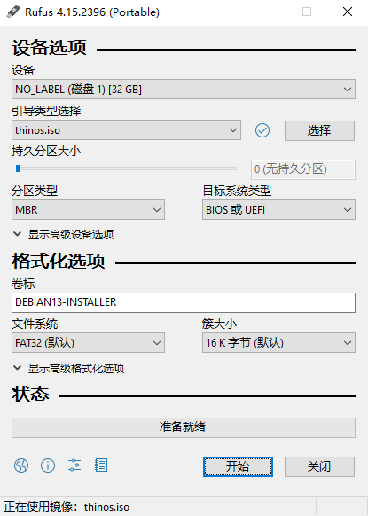
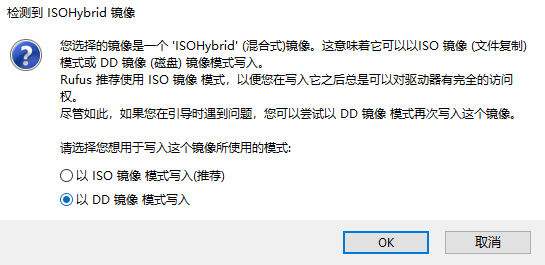
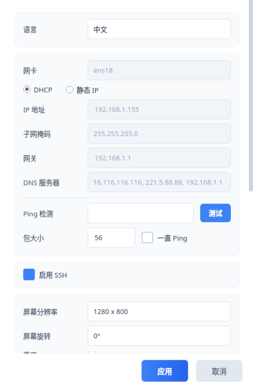
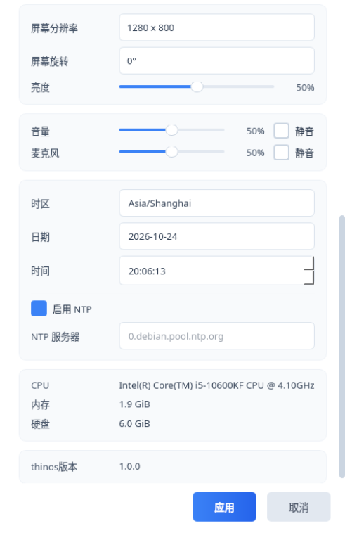
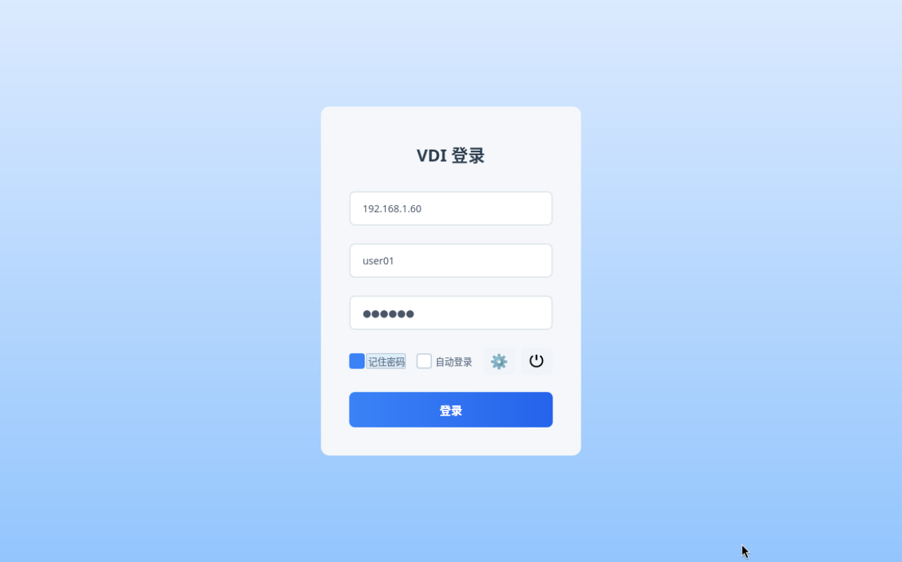
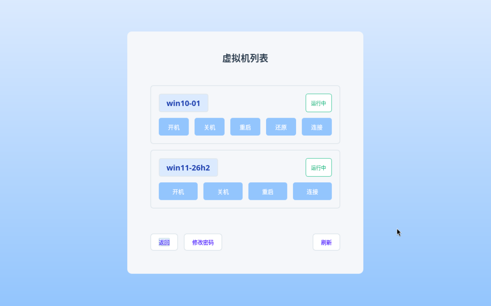
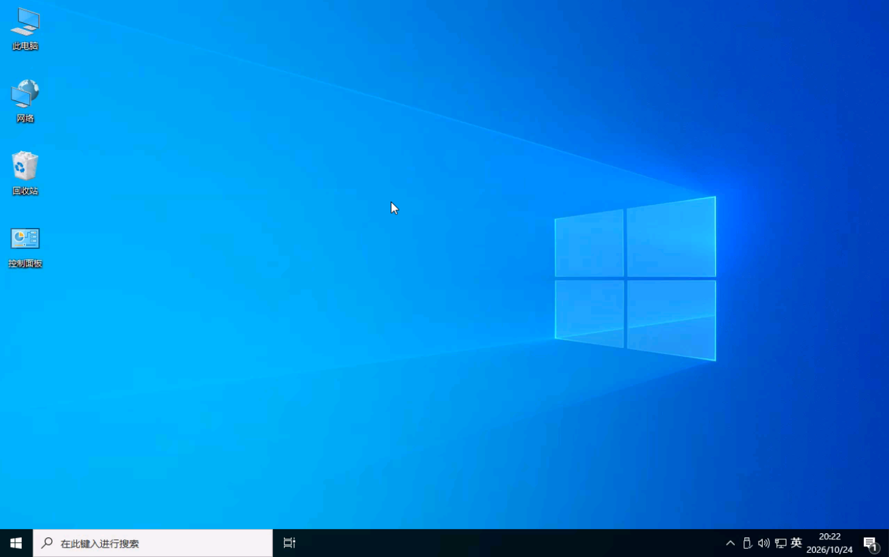
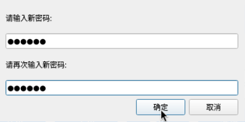
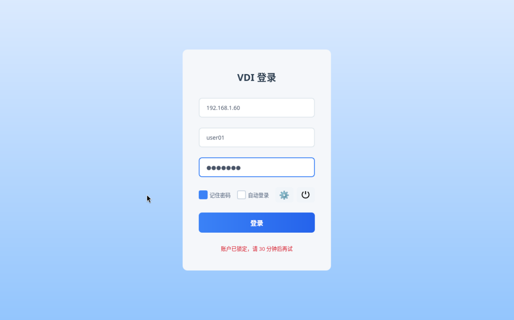

## 安装瘦客户机系统

### 一、rufus 制作启用 u 盘

注意选择 DD 模式

### 二、u 盘启动安装系统

通过快捷键选择 u 盘启动

安装thinos步骤：

1.输入磁盘数字，回车

2.警告磁盘数据被覆盖，回车开始安装

3.等待安装完成，拔出u盘，回车重启

### 三、配置瘦客户机系统

点击设置按钮，按需配置。

在登录页配置连接信息

### 四、登录

点击登录，进入虚拟机列表页面

点击连接，进入虚拟机

### 五、工具栏

鼠标靠近屏幕上方会有的悬浮工具栏显示，支持 CAD(Ctrl+Alt+Del) 快捷键、usb 设备重定向，断开连接

### 六、修改用户密码

点击修改密码按钮，修改用户密码

### 七、操作虚拟机

点击开机，关机，重启，还原（仅还原模式配置才有）按钮后，通过刷新按钮更新虚拟机状态。

虚拟机开机或重启操作后，大约 10-15 秒用户点击连接才能进入虚拟机，否则会提示连接失败。

### 八、用户锁定

输入5次错误密码，会导致用户被锁定，请联系管理员解锁

